<div align="center">



<p align="center">
  <a href="https://github.com/kingston-shasanth">
    
  </a>
  &nbsp;
  <a href="https://www.linkedin.com/in/kingstonshasanth">
    
  </a>
  &nbsp;
  
  &nbsp;
  
</p>

<p align="center">
  
</p>

<p align="center">
  <strong>Aspiring Software Engineer</strong> with a strong foundation in <strong>Artificial Intelligence &amp; Data Science</strong> at Karunya University, Coimbatore.<br/>
  Focused on engineering practical neuro-symbolic reasoning engines, assistive computer vision, and resilient full-stack architectures.
</p>

</div>

---

### `//` PROFILE OVERVIEW

I am an **Artificial Intelligence and Data Science** undergraduate at **Karunya University in Coimbatore, India**, dedicated to developing production-minded software where algorithmic models and disciplined engineering come together to solve concrete problems.

My work focuses on the intersection of **applied artificial intelligence**, **computer vision**, and **full-stack software engineering**. Rather than treating machine learning as an isolated research sandbox, I emphasize end-to-end system design—coupling calibrated models with resilient API services, normalized database schemas, and accessible user interfaces.

<table>
<tr>
<td width="50%" valign="top">

#### 🎯 Core Engineering Focus
- **Applied AI &amp; Neuro-Symbolic Reasoning:** Evidentiary retrieval, natural language inference, confidence calibration, and transfer learning for classification.
- **Full-Stack Architecture &amp; APIs:** Scalable microservices, asynchronous request pipelines, strict state isolation, and authenticated user workflows.
- **Accessible, Human-Centered Software:** Assistive technology engineered with empathy for low-vision and screen-reader users, including real-time multilingual voice feedback.

</td>
<td width="50%" valign="top">

#### 💼 Academic &amp; Technical Direction
- **Institution:** Karunya Institute of Technology and Sciences, Coimbatore
- **Program:** B.Tech in Artificial Intelligence &amp; Data Science
- **Current Technical Exploration:** Hybrid dense/sparse retrieval (FAISS + BM25), temperature-scaled confidence calibration, and low-latency edge inference.
- **Collaboration:** Open to engineering projects, open-source initiatives, and applied AI research.

</td>
</tr>
</table>

---

### `//` SELECTED PROJECTS

Four focused engineering systems demonstrating end-to-end architecture, applied machine learning, and clean software implementation:

<table>
<tr>
<td width="50%" valign="top">

### 01 · VERITAS Evidence Intelligence Engine
**Neuro-Symbolic Claim Verification &amp; Evidence Intelligence**

An audited claim verification engine coupling dense and sparse hybrid retrieval with cross-encoder Natural Language Inference, temperature-scaled confidence calibration, and 11-stage forensic telemetry.

- **Hybrid Evidentiary Retrieval:** Merges dense vector embeddings via FAISS with BM25 lexical keyword ranking using Reciprocal Rank Fusion.
- **Calibrated Verification:** DeBERTa-v3 cross-encoder NLI with temperature scaling ($T = 4.1039$) producing transparent evidence-grounded veracity decisions.

```
Stack: Python · PyTorch · DeBERTa-v3 · FAISS · BM25 · FastAPI · React 18 · Vite
```

[**Explore Repository →**](https://github.com/kingston-shasanth/VERITAS-Evidence-Intelligence-Engine)

</td>
<td width="50%" valign="top">

### 02 · NIRA Currency Intelligence
**Assistive Banknote &amp; Coin Recognition for Visually Impaired Users**

A full-stack assistive computer vision platform engineered to help visually impaired individuals recognize Indian banknotes and coins independently through real-time camera inference and voice feedback.

- **Deep Transfer Learning:** ResNet-18 classification pipeline trained across 14 banknote and coin classes, evaluated on a held-out test set.
- **Voice Guidance &amp; Accessibility:** Multilingual audio feedback across 13 Indian languages with native Android accessibility routing via Capacitor.

```
Stack: Python · PyTorch · ResNet-18 · FastAPI · React 19 · TypeScript · Capacitor · SQLite
```

[**Explore Repository →**](https://github.com/kingston-shasanth/NIRA-Currency-Intelligence)

</td>
</tr>
<tr>
<td width="50%" valign="top">

### 03 · RELOOP Refurbished Electronics Marketplace
**Full-Stack Circular Commerce &amp; Product Lifecycle Platform**

A production-minded circular electronics marketplace designed to address the refurbished trust deficit through verifiable condition grading, Digital Product Passports (DPP), trade-in valuations, and transparent order tracking.

- **Architectural Isolation:** Strict separation of payment method selection and payment status workflows with role-based JWT access controls.
- **Data Modeling:** Scalable MongoDB schemas with Mongoose modeling refurbished product lifecycles, refurbishment repair pipelines, and trade-in valuations.

```
Stack: React 18 · Vite · Node.js · Express · MongoDB · Mongoose · Bootstrap 5
```

[**Explore Repository →**](https://github.com/kingston-shasanth/RELOOP-refurbished-electronics-marketplace)

</td>
<td width="50%" valign="top">

### 04 · Smart Building Energy &amp; ESG Predictor
**ML-Powered Facility Consumption &amp; Sustainability Analytics**

An end-to-end machine learning web application analyzing multi-sensor historical building telemetry to model consumption patterns, evaluate emissions, and support ESG-guided facility decisions.

- **Multi-Target Predictive Models:** Gradient Boosting regressors tuned with RandomizedSearchCV to predict energy (kWh), water usage, carbon emissions, and sustainability scores.
- **Interactive "What-If" Simulations:** Interactive dashboard calculating estimated utility expenses and simulating occupancy, temperature, and HVAC adjustments.

```
Stack: Python · Scikit-Learn · Gradient Boosting · Streamlit · Pandas · NumPy
```

[**Explore Repository →**](https://github.com/kingston-shasanth/Smart-Building-Energy-ESG-Predictor)

</td>
</tr>
</table>

---

### `//` TECHNICAL SKILLS MATRIX

An organized inventory of programming languages, frameworks, libraries, and developer tools used across engineering projects:

<table>
<tr>
<td width="20%"><strong>Languages</strong></td>
<td>
  <br/>
  <sub><code>Python</code> · <code>Java</code> · <code>JavaScript</code> · <code>TypeScript</code> · <code>C</code> · <code>C++</code> · <code>HTML5</code> · <code>CSS3</code></sub>
</td>
</tr>
<tr>
<td width="20%"><strong>Frontend</strong></td>
<td>
  <br/>
  <sub><code>React.js (18/19)</code> · <code>Vite</code> · <code>Tailwind CSS</code> · <code>TypeScript</code> · <code>Capacitor (Mobile)</code></sub>
</td>
</tr>
<tr>
<td width="20%"><strong>Backend &amp; APIs</strong></td>
<td>
  <br/>
  <sub><code>FastAPI</code> · <code>Node.js</code> · <code>Express.js</code> · <code>RESTful APIs</code> · <code>JWT Authentication</code> · <code>Asynchronous Task Handlers</code></sub>
</td>
</tr>
<tr>
<td width="20%"><strong>AI &amp; Data Science</strong></td>
<td>
  <br/>
  <sub><code>PyTorch</code> · <code>DeBERTa-v3</code> · <code>ResNet-18</code> · <code>Scikit-Learn</code> · <code>FAISS</code> · <code>BM25</code> · <code>NumPy</code> · <code>Pandas</code></sub>
</td>
</tr>
<tr>
<td width="20%"><strong>Databases</strong></td>
<td>
  <br/>
  <sub><code>MongoDB</code> · <code>Mongoose</code> · <code>MySQL</code> · <code>SQLite</code> · <code>Relational &amp; Document Schema Design</code></sub>
</td>
</tr>
<tr>
<td width="20%"><strong>Tools &amp; Systems</strong></td>
<td>
  <br/>
  <sub><code>Git</code> · <code>GitHub</code> · <code>Linux CLI</code> · <code>VS Code</code> · <code>Postman</code> · <code>Cisco Packet Tracer</code></sub>
</td>
</tr>
</table>

---

### `//` GITHUB TELEMETRY & ACTIVITY

Live telemetry reflecting GitHub activity, repository development, and language distribution across public projects:

<table>
<tr>
<td width="50%" align="center" valign="middle">


</td>
<td width="50%" align="center" valign="middle">


</td>
</tr>
</table>

<p align="center">
  <a href="https://github.com/kingston-shasanth?tab=repositories">
    
  </a>
  &nbsp;
  <a href="https://github.com/kingston-shasanth?tab=overview">
    
  </a>
</p>

---

### `//` ENGINEERING PRINCIPLES

Four foundational practices guiding project architecture, implementation rigor, and technical continuous improvement:

<table>
<tr>
<td width="25%" align="left" valign="top">

#### `01` BUILD
**Practical Products**
Translating mathematical and computational models into dependable, end-to-end software products that address tangible user needs.

</td>
<td width="25%" align="left" valign="top">

#### `02` ENGINEER
**System Reliability**
Structuring robust API boundaries, strict type definitions, resilient error handling, normalized schemas, and calibrated outputs.

</td>
<td width="25%" align="left" valign="top">

#### `03` EXPLORE
**Applied Intelligence**
Investigating neuro-symbolic reasoning, dense/sparse search, computer vision models, and assistive interfaces with measurable utility.

</td>
<td width="25%" align="left" valign="top">

#### `04` REFINE
**Software Quality**
Maintaining high code quality, systematic version control discipline, comprehensive test suites, and continuous learning.

</td>
</tr>
</table>

---

### `//` GET IN TOUCH

I welcome opportunities to collaborate on applied artificial intelligence, discuss full-stack and backend systems, or explore software engineering roles.

<div align="center">

<p align="center">
  <a href="https://www.linkedin.com/in/kingstonshasanth">
    
  </a>
  &nbsp;&nbsp;
  <a href="https://github.com/kingston-shasanth">
    
  </a>
</p>


</div>
